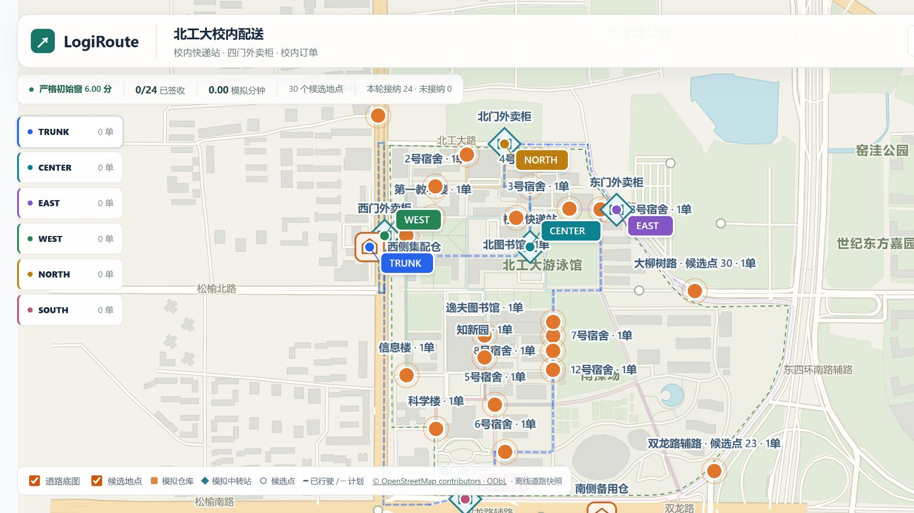
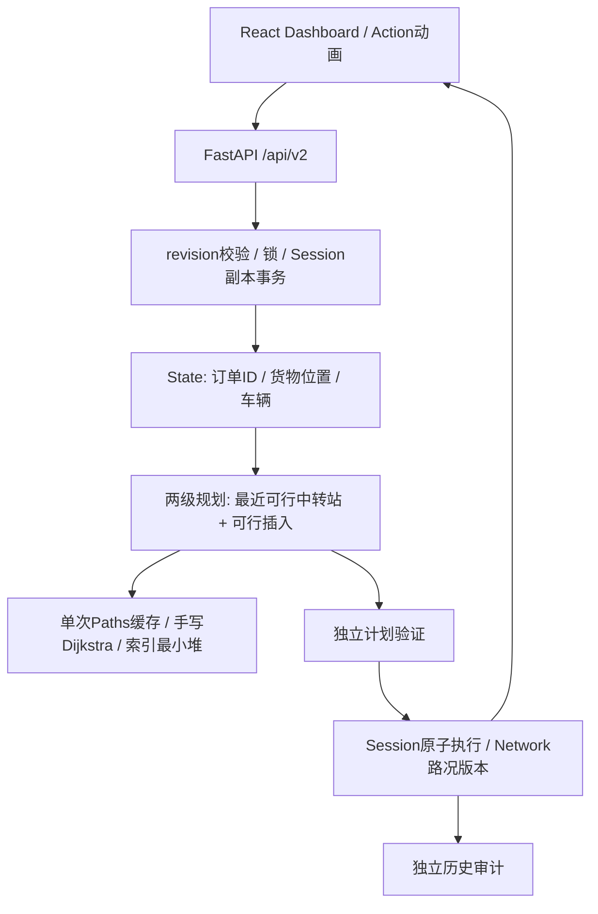

# LogiRoute — 校园两级智能配送系统

数据结构课程设计：在北工大校园及周边离线真实道路上，演示多车辆配送、严格签收时间窗、动态订单、模拟拥堵与安全重规划。核心图、最小堆、Dijkstra、优先队列及可行插入自主实现；React界面只展示后端事实。

**[最终课程交付包](docs/final-delivery/README.md)** · [答辩讲解](docs/final-delivery/defense.md) · [7分钟演示脚本](docs/final-delivery/demo-script.md) · [本轮验收报告](docs/final-delivery/report.md)

## 当前校园场景

- 固定342个路由节点、768条有向道路，保留真实道路方向和折线。
- 30个固定候选配送地点；默认24单，校内20、周边4。Seed改变订单，不改变校园路网。
- 游泳馆北侧校内快递站与东、西、北、南门外卖柜五个中转点；1辆干线车、5辆末端车。
- critical / urgent / normal三级优先级，逐车Decimal精确容量，同址多订单分别追踪。
- 新建校园场景默认严格预约窗，earliest限制服务开始、deadline限制签收完成，支持宽松对照。
- 动态新增、合法取消/显式过期、检查点重规划、方向性模拟交通、逐动作动画及独立历史审计。
- 全屏地图、订单/车队/时间窗抽屉；实验工作区提供独立双目标受控实例。



## 架构与数据结构



邻接表与反向索引维护唯一图真相；字典保留订单身份，事件列表提供可重演事实。当前两级入口与历史Phase3全局车队插入、V1单车接口并存，不能混用语义。详见[架构](docs/architecture.md)与[复杂度和算法讲解](docs/final-delivery/defense.md)。

## 安装与运行

Python ≥3.11，Node.js使用支持当前Vite的版本。核心算法只依赖标准库；完整Web/API测试还需要FastAPI、Uvicorn、HTTPX。项目采用src布局，配置位于config/。

```powershell
# 项目根目录，首次安装
python -m pip install -e .
python -m pip install fastapi uvicorn httpx
npm --prefix frontend ci

# 终端A：后端
$env:PYTHONPATH="src"
$env:PYTHONDONTWRITEBYTECODE="1"
python -B -m uvicorn logiroute.api:app --host 127.0.0.1 --port 8000

# 终端B：前端
npm --prefix frontend run dev -- --host 127.0.0.1
```

打开 [Dashboard](http://127.0.0.1:5172/)，后端接口说明位于 [API Docs](http://127.0.0.1:8000/docs)。历史单车界面保留在 [/legacy](http://127.0.0.1:5172/legacy)。会话保存在单个后端进程内存，重启需新建；不要用多个worker假设共享会话。

## 演示操作

1. 创建校园场景，默认Seed42。可在“场景与管理”选择严格/宽松模式再新建。
2. 打开订单，按楼名或ID搜索；点击地图候选点可在该地点下单。
3. 点击规划路线。打开“时间窗”，查看WEST服务顺序变化与原宽松路线灰色叠加。
4. 开始配送，播放/暂停动画或单步；“下一节点暂停”才请求业务检查点。装卸、等待和签收均由后端动作确认。
5. 动态新增订单后检查pending/未接纳原因，在检查点重新规划；新货物只在仓库装载。
6. “场景与管理”进入库存、交通、实验与审计；输入变化后旧比较失效。受控实验与校园会话隔离。

## 测试与实验

```powershell
$env:PYTHONPATH="src"
$env:PYTHONDONTWRITEBYTECODE="1"
python -B -m unittest discover -s tests -t .
Get-ChildItem frontend/tests/*.mjs | ForEach-Object { node $_.FullName; if($LASTEXITCODE -ne 0){throw "frontend test failed"} }
npm --prefix frontend run build
```

原794项Python测试及100个前端断言完整保留。本轮Python全量801/801通过、前端109个断言通过，类型检查与生产构建通过；实际执行统计以[最终报告](docs/final-delivery/report.md)为准，历史统计不冒充本轮结果。

- [双目标受控实验](docs/experiments/phase7-objectives.json)：同输入distance距离4/模拟成本18，cost距离6/模拟成本6；独立执行均完整。仅极小例枚举基准，不证明一般贪心最优。
- [严格窗A–G](docs/experiments/phase7-windows-final.json)：包括宽松/严格、极小不可行窗、等待、紧急竞争、同址不同截止与路况失效；保留partial案例。
- [五seed原严格实验](docs/strict-time-windows.md)：保留原始20次执行和跨进程指纹，不把受筛选教学样本当真实总体成功率。
- [性能与地图](docs/phase7-map-performance.md)：12/24单真实测量，36单因候选池不足明确拒绝；动态单不一定能立即被接纳。

## 数据真实性与边界

道路和建筑几何来自离线OpenStreetMap，保留原件、下载来源、SHA256与ODbL许可（[数据目录](data/bjut/README.md)）。校园快递站/柜位按用户描述近似定位，楼栋参考点与道路服务锚点不同；未测绘的设施不是精确真实楼门。订单、道路成本和交通均为模拟，不是实时导航、真实收费或真实配送业务。

启发式不保证全局最优；主目标最短路径闭包不枚举所有替代道路。valid不等于complete；计划接纳不等于签收；部分方案不能与完整方案直接宣称质量优劣。[历史贪心5/6反例](docs/v2-phase3-fleet-scheduling.md)继续保留。

## 历史与协作规范

[最终交付索引](docs/final-delivery/README.md) · [原README完整存档](docs/final-delivery/readme-history.md) · [阶段计划](docs/development-plan.md) · [AGENTS约束](AGENTS.md)

禁止以NetworkX、OR-Tools、NumPy、SciPy、heapq等替代课程核心实现；统一unittest，所有实验保留真实输入及测量，不覆盖历史证据。

MIT（项目代码）；OSM数据按ODbL及来源说明使用。
