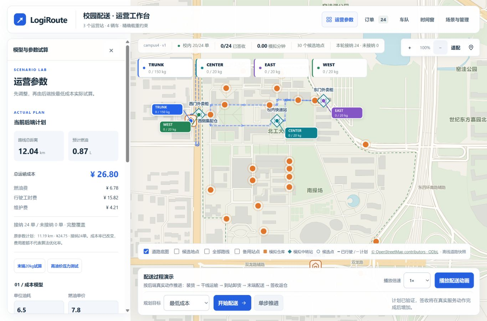

# 运营参数工作台：课程约束与真实路线试算

本轮按用户的新授权实施：使用 UI-UX-Pro-Max 优化工作台，减少视觉重叠和运营站点，加入逐车载重、油耗与成本参数。基线为 main 的 `e619714`，独立分支 `codex/operations-studio`。历史 Phase 7 交付与原始地图、实验和测试保留。本轮不合并 main。

## 课程题目逐项对应

来源为仓库根目录《第2题 电商物流配送路径规划系统.docx》，只读取内容，未改动原件。用户明确允许多车；原单车接口和 `/legacy` 继续保留。

| 要求 | 实际实现与核验范围 |
|---|---|
| 有向加权图、至少30节点/2仓库/15客户/3中转站/50路径 | 原校园路网保留342节点、768方向边、2仓库、30候选地点。新运营档案默认启用3个站点；其余2个设施仍在图中，可按需启用。未删掉道路方向或必要连通边。 |
| 邻接表、邻接矩阵、节点/边增删 | 继续使用 `LogisticsGraph` 原有增删及 `get_adjacency_list/get_adjacency_matrix` 接口和回归测试。当前地图不是任意拓扑编辑器；实时运输会话不支持直接删掉在途道路节点。 |
| 距离与成本两个优化目标、真实闭环路线 | 原规划器与手写 Dijkstra 不变。距离模式使用距离权重，成本模式使用本轮明确建模的费用；计划、实际配送与独立审计分开。 |
| 逐车容量 | 每车容量从原始输入转换 Decimal，逐单需求也保留原始精度；不使用车队总容量、float 中间累加或 epsilon。新档案统一解释为 kg。 |
| 交通变化至少20%触发重规划 | 仅新档案增加适配层触发：某方向行驶时间相对更新前增加至少20%，或封路，自动请求业务检查点；已进入动作按旧承诺完成，再生成并独立验证续程。不自动再次出发。失败保留真实货物和历史。 |
| 时间窗、超时记录与罚金 | 继承 earliest 限制服务开始、deadline 限制签收完成。超过截止但未签收的订单按配置每单50模拟元独立记账，不把罚金当作允许超时签收的理由。未到截止的未接纳订单不算已超时。 |
| 动态订单与紧急优先级 | 既有新增、合法取消/过期、三级优先级和检查点重规划继续使用。新增不会立即伪造接纳或签收；已装货取消限制继续生效。 |
| 自主数据结构与算法 | 未引入算法包、排序/堆库、第三方测试框架或图容器替换。原801项测试保留；本轮增加9项 unittest。 |

## 界面及地图

UI-UX-Pro-Max 检索命中 Logistics/Delivery 与 Minimalism & Swiss。生成记录位于 `design-system/logiroute-operations/MASTER.md`，页面覆盖说明位于其 `pages/operations.md`：采用蓝色主要操作、低噪声白色面板、4/8间距、数据对齐、44px操作目标、渐进展开和 reduced-motion；离线中文系统字体替代远程字体依赖，不采用营销落地页布局。

地图保留全屏背景。桌面参数面板打开时，画布真实预留346px面板及间距，重新投影，不用面板遮住西侧车辆。默认仅显示选中车辆路线、已分配配送点和3个运营站；可显式显示全部路线、候选池和备用设施。车辆的真实圆点仍位于实际道路/站点上，错开的是带引线的 ID/载重标牌。手写确定性避让考虑节点标签和屏幕边界，不篡改物理位置。

核对过[北工大官方校园地图入口](https://www.bjut.edu.cn/xxgk/xydt1.htm)及[研究生院指引](https://yanzhao.bjut.edu.cn/info/1021/1178.htm)。官方校园图适合设施位置校核，并不直接提供可替代当前图的路由道路数据。本轮继续保留 OSM 离线道路折线、方向和许可，并增加官方地图链接。未声称完成重新测绘或柜位精确校准。

研究过[高德 JS API 官方文档](https://developer.amap.com/api/javascript-api-v2/getting-started)：接入需要应用 key/安全配置；高德 GCJ-02 与当前 OSM 坐标不可直接混叠。本轮没有擅自申请 key 或调用外部路线求解器。真实路口限制、楼门和柜位仍需现场校准。

## 费用模型与配置边界

唯一参数配置：`config/operations_studio.json`。默认油耗6.5 L/100km、模拟燃油单价7.8元/L、行驶工时30元/h、维护费0.35元/km；这些是教学假设，不是现实报价。干线容量150kg，末端50kg；可逐车修改。上下界、道路模拟系数、压力预设、最低站点数与罚金均在 JSON。

对每条方向边 e：

```
fuel_e = distance_e × road_factor_e × fuel_per_100km / 100
cost_e = fuel_e × fuel_price
       + travel_time_e / 60 × driver_hourly
       + distance_e × maintenance_per_km
```

道路等级系数是明确配置的模拟系数。多种道路的耗油与行驶时间不同，调节费用构成可以改变 cost 模式的实际最短路径和插入决策。**不同参数不保证每次都改变路线**；distance 模式只改油价通常保持路线，只改变费用。实际全程统计包含出仓、途中、返仓；闲置车辆没有虚构燃油。

所有车辆共享参考油耗/费用率；模型未假设按车、按载荷动态变化的燃油曲线，不含怠速燃油、服务等待工资、真实路费、税费或碳排放。油耗和费用使用有限浮点道路指标；精确 Decimal 硬约束专用于需求与容量。模拟拥堵只增加行驶时间与相应工时费，未虚构额外怠速燃油。

## 试算隔离和接口

旧 `random/bjut/bjut-campus` 创建档案保持原规则。新前端选择 `bjut-studio`，3站4车；老会话可以继续查看，创建新档案后才有参数试算。

新档案严格窗生成耗尽时返回422及原始尝试明细。边界测试使用受控异常注入验证错误不会被适配层丢失；成功实验仍全部调用真实生成器、规划器和执行器，未用注入数据替代实验。

`POST /api/v2/sessions/{id}/trial` 接受 `revision`、完整 `parameters` 和目标（前端固定 `cost`）。只允许未执行、未改路况、所有货物仍在仓库的初始会话。后端复制原场景，逐订单保留 ID、目的地、需求、earliest、deadline；从距离/时间重算费用，不对旧费用重复乘系数；由原规划器生成、独立验证后返回新的会话 ID。原会话及修订号不变，过期 revision 返回409。容量过小的合法 partial 如实返回未接纳订单；独立验证不安全的草案不切换为有效计划。

改变容量/站点会使原严格窗的初始反事实证据失效，试算复制时移除该证据，**不会重新放宽原订单窗口**。界面时间窗面板说明证据失效，不继续显示旧因果对照。新试算保留原会话 ID 和原参数指标作比较；不同费率下成本差额不是算法优化率。已执行会话拒绝改参重置货物，应新建场景。

## 真实实验

原始记录：`docs/experiments/operations-studio.json`。重现入口 `PYTHONPATH=src python -B scripts/experiment_operations_studio.py`；脚本拒绝覆盖已有证据，重跑时先为输出选择新路径。Seed42、同一批24单/同一地点/同一宽松窗口，4组参数×2目标真实规划和执行；另有严格默认窗×2目标，总10次独立执行审计。

| 参数/目标 | 距离 km | 模拟费用 元 | 完整签收 | 相对原目标路线改变 |
|---|---:|---:|---:|---|
| 原参数 distance | 11.236925 | 25.691392 | 24/24 | 否 |
| 原参数 cost | 11.192668 | 24.751100 | 24/24 | 否 |
| 仅模拟油价30，distance | 11.236925 | 43.874700 | 24/24 | 否 |
| 仅模拟油价30，cost | 11.276654 | 43.638765 | 24/24 | 是 |
| 仅末端容量20kg，distance | 11.819788 | 27.155739 | 24/24 | 是 |
| 仅末端容量20kg，cost | 12.036738 | 26.804767 | 24/24 | 是 |
| 各车容量0.1kg，两目标 | 0 | 0 | 0/24，valid partial | 是；不能当作成本改进 |

严格默认窗的 distance/cost 均完成24/24并通过实际历史审计。浏览器另验证：严格窗场景降低末端容量为20kg后仅接纳23/24，宽松同单对照为24/24。该 partial 是容量、插入启发式与原窗口共同作用的实际结果，不证明整个路网无解。

8组参数实验的运行时间只度量真实规划调用，未添加睡眠或伪造时间；原始 JSON 保留规划耗时、路线动作、接纳/未接纳及独立报告。另2次严格默认窗执行附动作与审计，未单列规划耗时。参数压力实验不是现实油价预测，也不证明全局最优。

## 验证与模块职责

`dispatch/studio.py` 负责配置边界、隔离复制、方向边费用与指标；API 负责 revision/事务与交通触发；原 Session/规划/验证器保持物理执行职责。React hook只切换后端确认的新会话；Economics 面板保留未提交的字符串草稿；markers只布局标牌。

配置复制及重加权 O(V+E+N)，指标按实际驱动动作 O(A+N)。标牌搜索 O(M×(M+B)×C)，M是车辆数，B是节点标签数，C是有限环与视口网格候选数；它不参与路径规划。原规划与最短路复杂度见既有答辩文档。

第一轮全量809/809，0失败/错误/跳过，退出码0，534.421873秒，见 `operations-studio-regression.json`。随后补入新档案非法Seed边界测试，最终810项门禁及前端结果见验收记录。原测试文件和断言未删改。

| 全量门禁 | 测试/通过 | 失败/错误/跳过 | 退出码 | 真实耗时 秒 | 原始记录 |
|---|---:|---:|---:|---:|---|
| 首轮 | 809/809 | 0/0/0 | 0 | 534.421873 | `operations-studio-regression.json` |
| 补充非法Seed边界 | 810/810 | 0/0/0 | 0 | 581.692553 | `operations-studio-final-regression.json` |
| 生成耗尽明细适配补充后，发布门禁 | 810/810 | 0/0/0 | 0 | 570.629475 | `operations-studio-release-regression.json` |

最终门禁包含全部原801项和新增9项；命令为 `PYTHONPATH=src PYTHONDONTWRITEBYTECODE=1 python -B -m unittest discover -s tests -t .`。中间测试与最终发布门禁的记录分别保留，未用旧数量替代最终数量。

9个前端Node脚本共135项断言通过，其中26项新增标牌断言覆盖同址6车、确定性、输入不变性、边缘约束和极小画布。原109项保持不变。TypeScript检查和Vite生产构建通过，无新增依赖。

新档案另在 `PYTHONHASHSEED=1/2` 的独立Python进程中实际生成并规划，完整804123字节的场景/路线JSON一致，SHA256均为 `cdce36dbdb55b055e6c7746791943c914a1b15359df2923f3d2ef727ac2ab109`。比较含配置、节点、方向边权重/几何/metadata、逐订单、车辆、位置、货物位置及完整cost计划，不只是节点数量。记录见 `operations-studio-reproducibility.json`；脚本 `scripts/check_operations_studio_reproducibility.py` 可传新的输出文件名复验。

浏览器真实操作额外完成一次宽松Seed42/末端20kg的全流程：会话campus4、revision202、24/24签收、模拟时刻41.92分钟，四车空载回各自基地、独立历史审计valid/complete。完整后端快照保存在 `operations-studio-browser.json`，截图见 `docs/visual/operations-studio/`。这次浏览器流程与上述10次脚本实验单列统计。

依赖与排序审计见 `operations-studio-quality.json`：无禁用依赖、无新增排序工具调用；保留并披露原有7处辅助排序，未把它们冒充本轮新增算法。新增实验脚本和测试文件另通过AST排序扫描。



已检查390×844手机布局、1366×900桌面布局及默认1280×720。手机页面无水平溢出，车辆标牌可见；桌面实际DOM四车标牌互不重叠。屏幕过小或极端密集时标牌候选空间有限，不能承诺任何任意缩放都有足够标牌面积；可关闭面板、缩放、定位车辆并用车队卡片选择。

## 启动

默认后端8000，前端5172。若8000被其他应用占用，保留该应用，使用8001：

```powershell
$env:PYTHONPATH="src"
$env:PYTHONDONTWRITEBYTECODE="1"
python -B -m uvicorn logiroute.api:app --host 127.0.0.1 --port 8001
# 另一终端
$env:VITE_API_TARGET="http://127.0.0.1:8001"
npm --prefix frontend run dev -- --host 127.0.0.1
```

Vite只改变开发代理目标，未暴露新公共服务、引入依赖或改变生产默认接口。会话仍为单进程内存存储，重启会消失。
