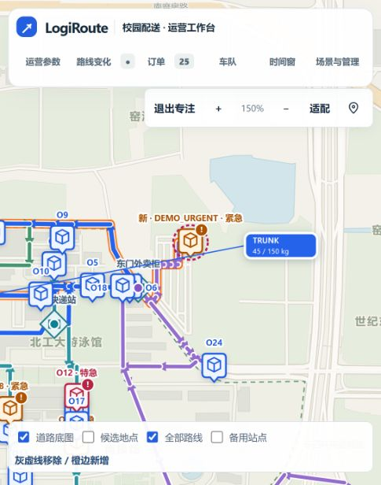
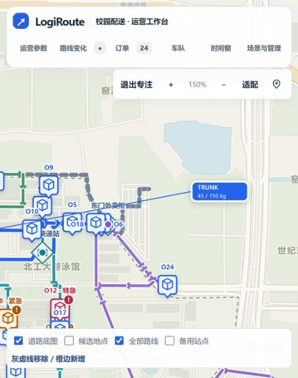

# 订单变更自动停靠、续程规划与地图清理

本轮按用户要求将新增和取消订单接入自动停靠与重规划。沿用既有订单状态、Decimal 载荷、签收完成截止、三级优先级、两级库存、手写 Dijkstra 与独立验证器。增加的是事件处理与展示流程，不替换调度算法。

## 原先为什么不一定看到路线变化

原 `Session.add_order()` 只把新单写入待处理队列，保留当前计划；它不会请求暂停或自动重规划。取消和优先级变更已有暂停行为，但需要用户手动完成已进入动作并重新规划。运营工作台此前只有显著交通变化接入了自动检查点规划。因此仅插单后继续查看旧路线，可能完全看不到新规划。

即使重规划已经执行，道路几何也不一定改变：新增地点可能位于原路线经过的道路；变化可能只涉及同址的另一张订单、服务顺序、时刻或装载清单。新订单也可能由于容量、签收窗口或现有保护任务无法接纳。界面必须显示真实的接纳／未接纳结果，不能为了让演示明显而绘制虚构绕行。

在途新单仍从仓库开始。干线车不能在道路途中凭空取得这件货物；原规划器可能先完成已载货行程、返仓后再运输新增货物。`urgent` 表示可行分配优先，不能突破物理库存、容量和窗口；`critical` 仍采用原来同车同批可用货物的服务顺序约束。

## 后端订单维护状态

每份会话快照新增 `order_control`。它是后端状态，前端不根据颜色、动画位置或时间自行推算订单是否完成。

| 字段 | 含义 |
|---|---|
| `enabled` | 是否已启用订单变更自动停靠与重规划 |
| `order_version` | 成功新增、取消、过期或优先级变更的计数版本；批量新增中的每张成功新单递增一次 |
| `planned_order_version` | 最近成功应用的独立验证计划所考虑的订单版本；没有应用过计划时为 `null` |
| `status` | `idle`、`waiting_checkpoint`、`applied` 或 `blocked` |
| `reason` | 当前处理结果或受阻说明；无说明时为 `null` |
| `change_kind` | 本轮最后的变更类型：`add`、`automatic`、`cancel`、`expire`、`priority`、`traffic`；尚无变更时为 `null` |

这里的版本维护的是**规划输入变更**。实际装货、卸货、行驶和签收由原有 `orders.status`、逐单位置、车辆载荷、事件与会话 `revision` 维护。每完成一张配送订单不会额外触发一次订单版本变更或重规划。

`planned_order_version == order_version` 只表示全部当前输入已经被规划器考虑，**不表示所有订单都被接纳，更不表示已签收**。安全的部分计划可具有 `status=applied` 和 `safe_to_apply=true`，同时将无法接纳的新单列在 `deferred`，并保持 `complete_all=false`。界面继续分别显示计划接纳与实际签收。

## 启用方式与兼容

新建会话可指定 `auto_replan:true`。新增、批量新增、取消、过期、优先级和交通命令也可以携带这个布尔字段，在同一事务中启用此模式并执行变更。Dashboard 新建会话默认启用；其订单变更请求也显式携带该字段，使已打开的历史会话在首次操作时获得相同行为。

启用后会话持续保持此模式。`auto_replan:false` 或省略字段只是“不请求新增启用”，**不会关闭已经启用的模式**。本轮没有增加关闭接口。非布尔值会被拒绝；失败的非法变更不会顺便启用模式或修改任何原状态。

未启用的历史 API/Core 调用保留原来的手动流程，原运营工作台交通自动重规划入口也继续兼容。已启用的会话把交通和订单变更送入同一个检查点状态流程，防止同一次事件重复应用两份计划。所有 API 写操作仍使用会话修订检查、锁和副本事务；陈旧请求返回冲突。

## 自动处理流程

| 当前状态／事件 | 处理与结果 |
|---|---|
| `idle` | 尚无待处理自动变更；初始计划仍可通过原规划入口生成 |
| 成功订单变更 | 记录新订单状态与版本，清除尚未进入的旧后继动作，请求 `waiting_checkpoint` |
| 变更时已在检查点 | 同一后端事务立即尝试规划，无需虚构一段停靠动画 |
| 变更时仍有已进入动作 | 保留这些动作的原道路、目标、清单与承诺；只推进到它们的完成边界 |
| 最后一个已进入动作完成 | 后端自动执行一次续程规划及独立验证，使用原计划主目标；没有原计划时采用 distance |
| 新计划安全有效 | 应用计划，更新已考虑版本，转为 `applied`，仅设置 `ready`，等待用户继续配送 |
| 新计划不安全 | 转为 `blocked`，保留新增／取消事实、原计划证据、实际位置、库存和载货，保持停靠 |
| `blocked` 后正常轮询 | 不重试，不继续旧后继动作，不自动出发 |
| 新的合法变更或人工重试 | 重新尝试续程；人工规划成功后清除受阻原因并转为 `applied` |

“停止配送”发生在真实动作边界。已进入的道路行驶、装载、卸载或客户服务必须按承诺完成；等待与结束动作可以停止。它不意味着把道路中间的车辆瞬移回仓库，也不撤销已经完成的签收。

前端停止普通播放循环，根据后端 `waiting_checkpoint` 状态顺序请求真实 `step`，并使用原动画显示这些已进入动作完成的过程。它既不自行计算路线，也不自动调用 `depart`。有请求进行中、网络不可用或请求错误时停止推进，保留错误供处理；成功接收后端快照后再决定下一步。重规划后先停留在路线对照，用户点击“播放配送动画”才继续新路线。

## 取消、签收与地图标记

用户界面的“删除订单”落实为原契约允许的**取消**，不物理删除唯一订单 ID。只允许尚未出仓、且尚未进入装货动作的仓库订单取消／显式过期；已出仓、已进入装货、已签收和其他终态订单继续拒绝非法取消。取消失败时没有状态、载荷、版本或模式开关的附带修改。

地图仅绘制 `pending`、`planned` 和 `in_transit` 的活跃订单。`delivered`、`cancelled` 和 `expired` 从包裹标记中移除，仍保留在订单中心、事件和独立历史审计中。同一目的地若还有其他活跃订单，地点标记保留，但数量和详情只包含剩余活跃单；不以目的地数量代替订单数量。

订单图层清理不删除真实道路或候选配送地点。候选池开启时，同一个地理地点仍可能作为空候选点出现，不能把它解释为仍有一张待送订单。订单终身唯一性检查同样覆盖已送达、已取消和已过期的 ID。

## 刷新和对照边界

后端保存自动处理状态。刷新同一会话后，前端会从真实快照恢复 `waiting_checkpoint` 的推进或显示 `blocked` 的原因。服务进程本身仍采用项目原来的内存会话模型，重启后端不会凭空恢复丢失的会话。

路线“变更前／当前／变化叠加”的前后证据仍是本页内存数据，刷新或切换会话会清空本地对照；这与后端待处理订单状态是否保留是两件事。图层对照只改变绘制的路线，不回滚车辆、载荷、订单或模拟时刻。

已真实完成的旧路段从可比较的剩余路线中排除，不能把正常配送进度当成“重规划移除”。方向路段仍按逐车、逐方向去重比较，服务顺序独立显示。详见[订单标记与路线对照](route-visibility.md)的计数口径。

## 本轮验证与实验记录

后端新增 `tests/test_dispatch_order_replan.py`，原有测试文件及断言保留。先运行新增回归确认缺少入口与维护状态，初次得到6项失败、1项错误；实现后补足为9项测试。与原 API、会话和运营参数测试合计 **30项通过，11.760秒，零失败／错误**。

覆盖在途插单暂停、原始精确小数需求、检查点前后真实载荷与位置、旧事件保留、同址订单独立、合法取消、终态 ID 禁止复用、非法已装货取消无副作用、批量／优先级／过期版本、旧手动模式、全部签收不触发额外规划、无法接纳的新单保留、受阻后人工恢复，以及交通事件只生成一次自动计划。

最终完整 Python 回归 **819／819通过**：保留原810项，新增9项，失败0、错误0、退出码0。`unittest`记录256.456秒，外部墙钟258.6798219秒。输出仅包含历史 `/api/plan` 算法字段的弃用警告，该警告不是测试失败，也没有用来替代错误处理。

前端当前 **270项断言通过**，类型检查及生产构建通过（81个模块）。相关30项定向结果与819项完整结果分别记录，不混用数量。完整Python测试输出及命令见[验证记录](experiments/order-replan-tests.json)。

新增生产代码未引入禁用算法依赖或现成排序。全仓源码AST扫描无禁用库导入，同时发现历史 `dijkstra.py`、`logistics_graph.py`、`scheduling/depot.py` 中共7处 `sorted()`；已逐文件确认与 `70f29e0` 基线一致，本轮未修改这些文件。不能把“无新增”描述为全仓已无历史排序调用；位置记录在同一验证JSON中。

真实 HTTP 实验脚本为 `scripts/check_order_replan_live.mjs`，实际通过 **1247项断言，54.1211017秒**。原始逐请求和快照记录保存在[无损压缩JSON](experiments/order-replan-live.json.gz)，[结果摘要](experiments/order-replan-live-summary.json)包含源字节SHA256、压缩文件SHA256和解压一致性检查。完整源JSON为34,400,514字节，压缩为3,716,776字节；压缩不删除失败或未接纳结果。

两组均使用Seed42、24张初始订单，先实际装货进入第一条道路，在模拟时刻3新增 `LIVE_MOVING_URGENT`：P27、1kg、urgent、窗口3–2003分钟。新增后各只完成一个已进入动作，于3.1176871442699103分钟到达检查点，后端自动规划，未自动出发。

| 指标 | 严格预约窗 `campus2` | 宽松对照窗 `campus3` |
|---|---|---|
| 新增后自动流程 | `applied`，安全续程 | `applied`，安全续程 |
| 新急单接纳 | 未接纳，原因 `completion_deadline` | 接纳，计划覆盖25单 |
| 新增后的方向路段差异 | 新增0／移除0 | EAST、TRUNK变化，新增32／移除0 |
| 取消仍在仓库的新急单 | 自动规划，新增0／移除0 | 自动规划，新增0／移除32 |
| 取消后实际执行 | 203次step，原24单签收 | 188次step，原24单签收 |
| 最终状态 | 24 delivered、1 cancelled | 24 delivered、1 cancelled |
| 最终模拟时刻 | 45.39750057810525分钟 | 41.98868509984508分钟 |
| 最终独立历史审计 | valid／complete_all 均true | valid／complete_all 均true |

严格场景中，自动重规划已经执行，但现有启发式未接纳新增急单，不能据此宣称道路网络已被证明无解，也不能强行画出新路线。宽松场景显示实际新增32条方向路段，再通过合法取消显示同一批32条路段从计划中移除。两组最终活跃订单分组均为0；取消订单的ID和记录保留，因此完整签收口径是剩余24张有效订单，而不是把取消单统计为已签收。

两个场景的初始时间窗不同。宽松结果用于检验明显的几何变化，不能替代严格约束下的未接纳事实，也不能据此宣称所有在途紧急插单都可行。

## 浏览器实际演示

在本地 Dashboard 另建 Seed42 宽松场景，通过界面规划、开始配送、单步完成装货，在干线车进入第一条道路后新增 `DEMO_URGENT`（P27、1kg、urgent、3–2003分钟）。没有点击手动暂停、检查点推进或重新规划；界面自动推进这一个已进入动作并展示独立验证结果，干线原45kg载货保持不变。

实际界面显示 EAST 新增19条、TRUNK新增13条方向路段，新订单标记及橙色路线描边可见。随后在订单中心合法取消这张仍在仓库的订单，界面自动再次规划，显示相同32条方向路段被移除，急单标记数量由1变为0，活跃地图标记由25变为24。取消后停留在“变化叠加”，等待用户继续配送。

窄窗口查看路线时可点击“专注地图”，收起统计、车辆选择和播放浮层；“退出专注”恢复操作。移动端切换变更前／当前／叠加模式后自动收起侧面板，地图仍使用原坐标。地图对照与浮层收起均不改变后端状态。

| 新增后：橙边表示新增 | 取消后：灰虚线表示移除 |
|---|---|
|  |  |

另外保留[变更前路线](visual/order-replanning/before.jpg)、[新增接纳结果](visual/order-replanning/accepted.jpg)与[取消后的逐车变化](visual/order-replanning/cancelled-result.jpg)。本次浏览器停在取消后的检查点；原24单全部签收和活跃图层清空由上面的独立HTTP实验实际执行并验证，未把浏览器尚未执行的步骤写成已执行。
