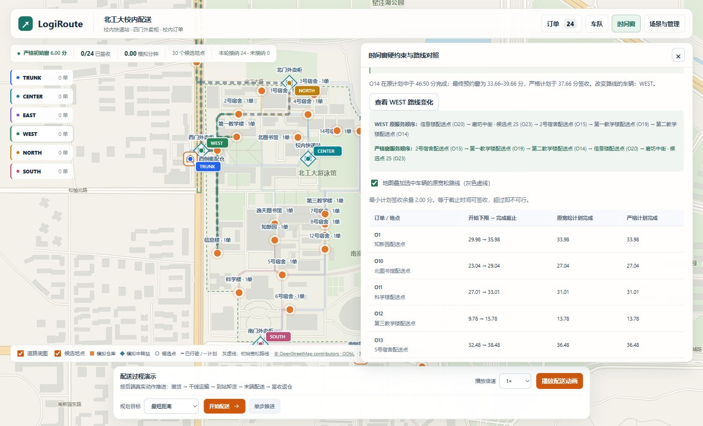
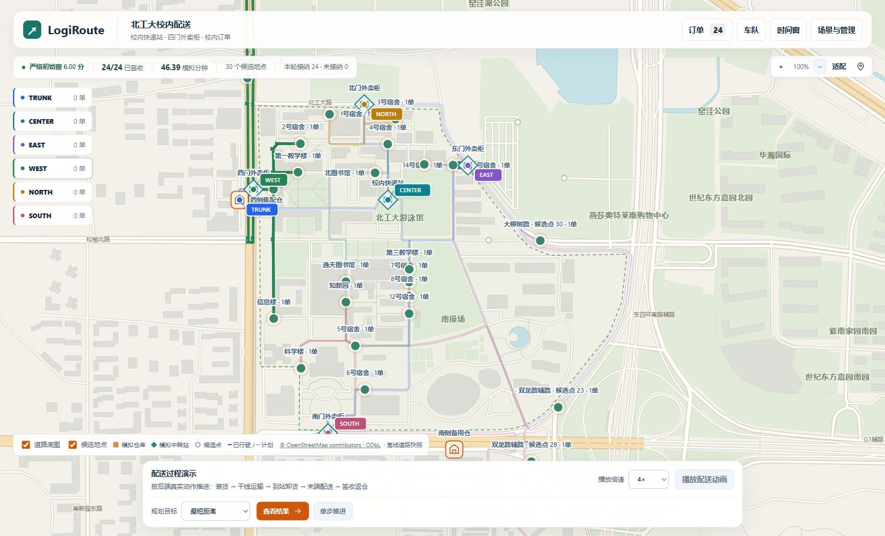

# 严格签收时间窗与路线变化验收

## 问题与正式契约

原校内订单配置允许在 0–2000 模拟分钟内配送，而实际配送约 47 分钟完成。生产规划器已有硬约束，但演示输入几乎不会触发它。本轮为 `bjut-campus` 新建场景默认启用严格预约窗，保留显式 `relaxed` 宽松对照入口。

最早时间限制服务开始，截止时间限制**签收完成**。到达后仍须等待、服务，并向后传播整条路线时间；完成时刻等于截止允许，超过即不可行。容量仍逐车全程 Decimal；订单 ID、目的地、需求、三级优先级、道路和车辆不因对照而改变。无法服务的订单保留明确原因。没有重写贪心、Dijkstra、独立验证器或执行器。

这些窗口是模拟预约数据，不代表真实客户预约。生成器通过真实可行计划构造有约束力的测试输入，生产规划仍重新求解，不直接采用生成时的见证路线。

## 文件与职责

```text
config/campus_time_windows.json                  窗口政策及有限尝试预算
src/logiroute/algorithms/window_calibration.py    确定性预约窗构造与效果证明
src/logiroute/dispatch/time_windows.py            JSON 配置适配
src/logiroute/dispatch/generation.py              已验证生成入口
src/logiroute/api/routes/dispatch.py              可选 window_mode 参数
src/logiroute/dispatch/session.py                 初始对照证据序列化
frontend/src/dispatch/components/TimeWindows.tsx 时间窗、逐单时刻和顺序对照
frontend/src/dispatch/windows.mjs                 初始证据有效性绑定
tests/test_strict_windows.py                     六项新增 unittest 回归
scripts/experiment_strict_windows.py             真实规划、执行及跨进程实验
```

算法位于 algorithms 包，JSON 适配与 UI 各有独立职责；没有新建图容器、第二套最短路或求解器依赖。

## 构造流程与配置兼容

1. 对原始输入运行 distance 规划，要求完整可行。
2. 手写确定性插入比较，按原完成时刻从晚到早、ID 决胜，最多探测六个订单；将探测订单截止提前五分钟。
3. 仅对真实完整可行的见证，以配置余量 2、4、6、8、12 分钟构造预约窗。窗口与原始最早时间、截止时间取交集，不得放宽用户边界；窗口宽度预算 30 分钟，最终截止上界 90 分钟。
4. 分别重新运行 distance、cost，两者必须完整可行。比较排除时间戳和等待动作的真实道路、服务、货物动作结构；要求路线确实改变，且原计划存在完成超时。
5. 独立验证器从严格输入重新验证原宽松方案，必须拒绝。实验反事实验证仅更新输入指纹以继续物理校验，不修改正式计划或绕过正常应用入口。
6. 保存所有尝试证据。穷尽时拒绝生成，窗口生成失败不通过换订单、换 seed 或回退宽松窗掩盖问题。

`timing.window_end=2000` 保留原含义，用于原始候选输入与显式宽松对照。底层 `make_state()` 仍构造原始候选；公开接受入口 `generate_state()` 对配置了政策文件的校内场景施加预约窗并验证。其他历史 profile 不启用该政策；不支持的 mode 明确拒绝。

严格新场景自动新增订单默认窗口宽度为 20 分钟，显式提交的窗口仍按原输入校验。现有会话和已下单窗口不被自动改写；没有引入自动计时过期或放宽截止规则。

设 P 为探测数、S 为余量级数、N 为订单数，T 为一次现有规划耗时，B 为含图的状态大小。包含手写插入排序、状态复制和证据构造，时间上界 O(N²+(1+P(1+2S))T+PS(B+N))，空间 O(输入及计划+PSN)。P≤6、S=5 是配置预算；生成会增加真实规划开销，不承诺全网最优或任意输入都成功。

## 可核验的路线变化

Seed 42 的 O14（第二教学楼）原计划完成时刻为 46.4973 分，最终预约窗为 33.6598–39.6598 分，严格计划完成时刻为 37.6598 分。

WEST 原服务顺序：信息楼 O20 → 磨坊中街 O23 → 2号宿舍 O15 → 第一教学楼 O19 → 第二教学楼 O14。

严格窗服务顺序：2号宿舍 O15 → 第一教学楼 O19 → 第二教学楼 O14 → 信息楼 O20 → 磨坊中街 O23。信息楼最早服务时间为 36.70 分；原先先送信息楼的做法与新预约窗不兼容。实际经过某节点不等于该订单已签收。

原计划在严格输入下有 O14、O15、O19 三张订单完成超时，独立验证拒绝。证据 `probe_deadline=41.4973` 是构造中间探测值；最终权威窗口是 `orders[].earliest/deadline`，界面显示最终 39.6598 截止。

## 实验结果

原始数据见 [strict-windows-results.json](experiments/strict-windows-results.json)。五个 seed × 两种窗口 × 两种目标，共 20 次真实执行；每次经过独立验证，均 valid 且 complete，实际逐单签收满足窗口，全部车辆最终返程。两种窗口对照保留同一批订单、需求、优先级、车辆和道路。

| seed | 窗口宽度/分 | 原路线完成超时订单 | 改变车辆 | 宽松距离/km | 严格距离/km | 宽松/严格最终时刻/分 |
|---|---:|---:|---|---:|---:|---:|
| 0 | 6.00 | 3 | WEST | 14.156 | 14.227 | 47.603 / 47.283 |
| 1 | 5.166–6.00 | 4 | CENTER、SOUTH、TRUNK、WEST | 14.406 | 16.014 | 42.665 / 42.165 |
| 42 | 6.00 | 3 | WEST | 14.387 | 14.459 | 46.713 / 46.392 |
| 100 | 6.00 | 3 | WEST | 11.900 | 12.097 | 46.282 / 46.982 |
| 2026 | 6.00 | 3 | EAST | 13.489 | 13.971 | 45.827 / 47.128 |

表格四舍五入仅用于展示，不用于可行性判断。当前配置成本为距离的统一倍数，因此 cost 与 distance 路线相同；没有据此声称目标优化性能提升。严格窗可以增加距离。最小计划签收余量为 0.757–2.000 分。真实单次规划耗时 0.2565–0.5715 秒，严格生成耗时 1.9621–2.9090 秒；这些是本机该次测量，并非性能保证。

每个 seed 在 PYTHONHASHSEED=1、2 两个独立进程中比较完整严格输入和两种目标的完整路线指纹，共十个子进程，全部相同。修复原始最早时间交集边界后，再次核验五个 seed 的完整指纹与已保存原始实验逐一完全一致，未覆盖原始数据。

负例：新增 `IMPOSSIBLE-WINDOW`，要求 1 分钟前签收，而服务本身需要 2 分钟。规划保留原 24 单，新增订单明确 `completion_deadline`；结果 valid、partial、complete_all=false，没有伪造 25/25。

小型有向图回归在优先级不变时，宽松路线 OA→OB 距离 3；OB 完成截止 2 迫使改为 OB→OA，距离 5。恰好完成于 2 可接受，截止 1 明确拒绝；提前到达等待以及服务后的下游传播同时覆盖。

## 验证与界面

先新增六项回归并确认失败，再实现。额外边界断言复现“原最早开始 30 被生成器放宽至 28”的问题，修复为窗口交集后通过。旧测试及断言没有删除或放宽。

- 初次完整回归：794/794，通过，0 失败、错误、跳过，退出码 0，460.2334 秒；证据 [strict-windows-regression.json](experiments/strict-windows-regression.json)。
- 最终交集修复后完整回归：794/794，通过，0 失败、错误、跳过，退出码 0，497.1227 秒；证据 [strict-windows-final-regression.json](experiments/strict-windows-final-regression.json)。
- 原 788 项保留，新增六项；相关旧场景/API/地图定向 19 项通过。前端原 90 个断言保留，新增十个证据绑定断言，共 100 个通过。TypeScript 检查及 Vite 生产构建通过。
- 实机 Dashboard 验证严格与宽松创建、逐单表、WEST 服务顺序及灰色原路线；一次动画真实完成 24/24、各车载荷归零。执行后初始叠加自动禁用。390×844 响应式测试抽屉可滚动、表格局部横向滚动，页面无横向溢出；测试视口已恢复。

“时间窗”按钮展示初始 distance 对照，灰色虚线代表原宽松路线，彩色路线来自当前真实计划。开始执行、订单字段/数量/状态改变、路况版本改变或目标改为 cost 后，初始叠加停用，表格明确标注历史初始对照，避免误导。





## 限制与停止边界

本轮证明选定样本中窗口会改变路线、负例会被拒绝，以及两个目标的真实完整配送。构造数据不能证明一般订单分布下的成功率或全局最优；有限贪心失败不能证明全网无解，主目标最短路径闭包也不枚举所有可替代路径。后续修改真实订单或拥堵后必须重新规划并独立验证，初始可行证据不延伸到修改后的场景。没有实施新的配送阶段。
