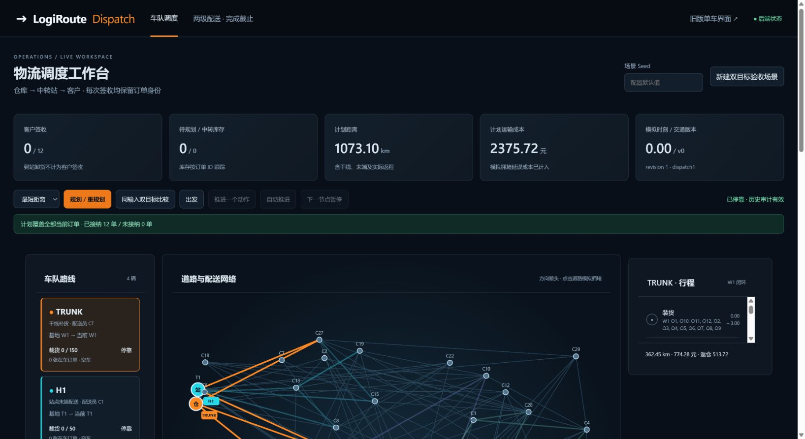
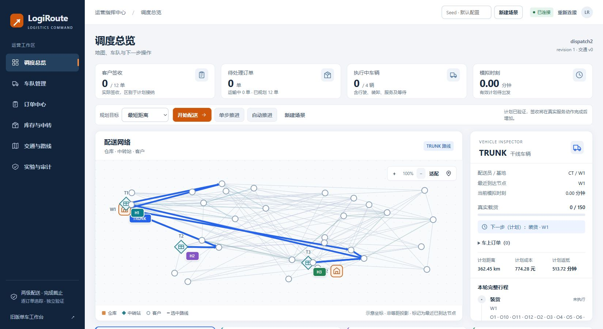

# Phase 6.1 — Enterprise Logistics Command Center

## 范围与基线
基线6362aa939f28a3034f2e00984e266e5a484ad9dd，本地/远端相同，初始工作区干净。
独立分支feat/phase6-1-dashboard-redesign，创建前本地和远端均无同名分支。
本轮只改前端及交付文档；Phase 6后端、全部既有测试与/legacy业务保持冻结。

## Skill实际情况
检查项目.agents/.codex、用户.agents/skills（含Junction）、.codex/skills、插件缓存，
未发现ui-ux-pro-max，也无原生skills.list工具提供该包；没有安装或声称调用。
采用用户给定的Enterprise Logistics Command Center方向与本项目实际状态结构自行设计。

## 改造前证据与设计决策
[1650×900 CSS视口原页面](visual/phase6-1/before-1650.jpg)：五张KPI挤占高度、地图约在y=517开始，
深色细线和小字拥挤，车队/行程/订单/交通/事件同页展开；所有操作同等突出。
比较结果独立state不会随输入更新失效，页头常绿且404没有专属恢复状态。

采用深海军蓝232px导航、68px工作栏、浅灰主背景、白色容器、橙色单一主操作。
六个真实切换工作区：总览、车队、订单、库存与中转、交通与路线、实验与审计。
总览最多四个业务KPI，地图在操作栏下成为主画布；右侧选中车辆详情。
站点用形状和标签区别，客户默认不铺满标签；选中路线高亮、普通道路低对比。
不采用无业务依据的装饰KPI，不引入地图/状态/UI依赖，不计算物流决策。

## Token
沿用frontend/src/styles/tokens.css语义变量；在.dispatch作用域覆盖色板、字号、间距和尺寸，
旧页面仍继承原:root值，不再保留旧dispatch暗色字面量主题。
正文15px、辅助14px（仅地图/版本辅助12px），标题28/24/18px；8px主间距、4px微调。
白色容器14px圆角、控件8px；轻阴影；180ms反馈；键盘focus-visible蓝环，尊重reduced-motion。
蓝/青/紫/绿对应车辆，红色仅错误、封路/风险，橙色承担主操作。

## 验收记录
以下为真实运行结果，不以设计计划代替验收。

### 新旧布局对照
| 项目 | Phase 6原页面 | Phase 6.1 |
| --- | --- | --- |
| 任务架构 | 所有模块默认展开 | 六个真实切换工作区，URL hash同步 |
| 主要背景 | 全深色 | 深蓝侧栏、浅灰工作区、白容器 |
| KPI | 五卡混合计划距离/成本 | 四卡：签收、待处理、车辆、时刻 |
| 1650×900地图 | y约517起，首屏下半裁切 | y358–878，520高；详情同步可见 |
| 地图标签 | 所有客户文字默认显示 | 仓库/站点/选中服务点，其他悬停/点选 |
| 操作 | 并排同等强调 | 依后端ready/running/needs_replan等事实强调下一步 |
| 比较结果 | 独立state，可残留 | session+revision+traffic_version+fingerprint绑定 |
| 连接 | 永久绿色文案 | 健康请求/快照实际结果；断线、404、重试可见 |




### 组件职责与实际文件
```text
frontend/src/styles/tokens.css              复用语义Token，dispatch局部主题
frontend/src/dispatch/
  Dashboard.tsx                            页面编排、选中项、确认操作
  types.ts / presentation.ts               API形状和展示标签
  sync.mjs / sync.d.mts                    版本、比较、时间轴证据、错误反馈
  viewport.mjs / viewport.d.mts            O(V)仿射示意投影，边渲染O(1)取点
  hooks/useDispatchSession.ts              唯一网络/命令入口、锁、轮询、epoch
  hooks/useNetworkViewport.ts              容器尺寸、缩放、重置和定位
  components/Common.tsx                    SVG图标、徽标、空状态、原生模态确认
  components/AppShell.tsx                  导航、连接、工作区标题
  components/Operations.tsx                KPI、下一步操作、上次计划覆盖
  components/NetworkCanvas.tsx             真实节点/道路/Action/当前位置
  components/Fleet.tsx                     车辆概览、选中详情、证据时间轴
  components/OrderTable.tsx                表格筛选、精确字符串需求表单、订单操作
  components/TaskPanels.tsx                库存、交通、比较、事件分页
  styles/shell.css / components.css        响应式布局与展示层
  dashboard.css                           仅聚合样式，旧暗色主题已移除
frontend/tests/dispatch-consistency.mjs    新状态断言
frontend/tests/dispatch-viewport.mjs       新投影边界断言
```
原frontend/tests/dispatch-sync.mjs未修改。没有新增依赖，package.json和lockfile保持不变。
客户端不执行路由、调度、容量决策或库存求和；载荷条Number仅作示意，准确数值仍显示原Decimal字符串。
投影根据真实模拟坐标独立适配两轴，不代表地理距离；原始坐标可查看，真实路程仍来自Plan/Action。

### 状态与交互证据
- 同输入distance/cost实际比较后，新增UI-P61特急订单；原始需求
  `0.10000000000000000000000000001`完整呈现，状态为待规划，旧比较立即消失。
  已应用计划继续保留，且界面称“上次计划”，不会将接纳数量冒充签收。
- 干线实际装载`20.10000000000000000000000000001 / 150`，在W1→C21行驶时封路。
  已进入动作按旧版本完成，在C21停靠保留13张在车订单，交通v1重规划接纳13/13。
- T3实际出现7张到站订单，仍为运输中；库存页逐单显示需求，未合并同址订单。
  随后通过后端step自动推进完成13/13签收、0辆执行中，模拟时刻672.97分钟。
- 地图100%→125%→100%缩放/重置；键盘Enter选择W1详情，Space/Enter选择车辆；
  H2/TRUNK地图、选中详情、行程联动。未实现拖拽，避免未验收的鼠标/触摸拖拽语义。
- 种子自动入单、特急优先级确认、取消DYN1、显式过期DYN2均通过真实API，终态ID保留。
  重复O1被真实API拒绝，表单保留输入，中文错误可见，不显示成功。
- 停止本轮本地服务后真实显示连接失败、保留旧快照、禁用写操作；重启后404明确提示旧会话失效，
  确认新建后恢复。没有改变后端代码或原子执行语义，重启丢内存会话是既有边界。
- 409刷新反馈有专门纯函数断言，原Python API回归覆盖冲突；本轮实际外部pause被轮询先接收，
  未宣称捕获到409浏览器弹条。请求epoch拒绝旧会话响应，低revision不能覆盖新快照。
- 时间轴仅使用当前动作及最近一次计划应用之后的实际事件；不根据时钟猜测完成。
  无证据时显示阶段未确认；未来动作暂停时显示待重规划；下一计划动作明确标注“计划”。

### 视口与截图
[浏览器几何与交互记录](visual/phase6-1/browser-evidence.json)保存真实尺寸和检查结果。

| 视口 | 地图边界 | 默认节点 | 页面横向溢出 | 截图 |
| --- | --- | --- | --- | --- |
| 1650×900 | y358–878，高520 | 35/35在画布内 | 无 | [总览](visual/phase6-1/overview-1650.jpg) |
| 1366×768 | y354–754，高400 | 35/35在画布内 | 无 | [笔记本](visual/phase6-1/overview-1366.jpg) |
| 1920×1080 | y358–978，高620 | 35/35在画布内 | 无 | [大屏](visual/phase6-1/overview-1920.jpg) |
| 390×844 | 纵向堆叠，地图高480 | 35/35在画布内 | 无 | [首屏](visual/phase6-1/overview-390.jpg)、[全页](visual/phase6-1/mobile-full.jpg) |

移动端订单表在自身容器内横向滚动，页面不横向溢出；筛选、模态表单、错误反馈及键盘焦点已实测。
键盘导航焦点蓝环实测可见。reduced-motion规则已审查，未改变操作系统偏好进行单独模拟。

交互截图（过程截图保留真实当时状态）：
[TRUNK详情](visual/phase6-1/trunk-inspector.jpg)、[特急入队](visual/phase6-1/critical-order.jpg)、
[封路/暂停](visual/phase6-1/traffic-paused.jpg)、[真实中转库存](visual/phase6-1/hub-inventory.jpg)、
[全部签收](visual/phase6-1/delivery-complete.jpg)、[双目标比较](visual/phase6-1/comparison.jpg)、
[订单操作](visual/phase6-1/order-management.jpg)、[中文表单错误](visual/phase6-1/order-error-localized.jpg)、
[空状态](visual/phase6-1/empty-state.jpg)、[连接失败](visual/phase6-1/connection-failed.jpg)、
[会话失效](visual/phase6-1/session-missing.jpg)、[旧页面](visual/phase6-1/legacy.jpg)。
迭代中原英文错误截图order-validation-error.jpg也保留，不伪造其为最终中文提示。

### 技术门禁
- npm run typecheck：通过。
- npm run build：通过，65模块；最终JS约224.61kB（gzip73.94kB），无新增依赖。
- Node assert：原5条顺序断言、新34条比较/快照/时间轴/传输断言、新22条投影断言，共61条通过。
- Python unittest：767/767，退出码0，252.955070秒；失败0、错误0、跳过0。
  [完整原始回归输出](experiments/v2-phase6-1-regression.json)。当前767项（含原728项）全部保留。
- 最终新标签页真实创建/规划后控制台错误0。迭代途中替换文件曾产生短暂HMR重载错误，
  已修复并以全新加载复核，不能将历史HMR记录删掉后冒充从未出错。
- git diff --check通过；对基线执行src/、tests/、config/、pyproject、前端依赖及旧App/旧状态测试差异检查均为空。

### 边界与剩余限制
本轮没有发现未修复的功能阻断。移动端完整地图与详情需纵向滚动，客户密集区域允许缩放点选；
不把示意图当等比例GIS，不做GPS插值、拖拽、路线求解或本地库存推演。
未进行完整屏幕阅读器和独立正式WCAG认证；409真实竞态弹条没有单独截图，反馈策略和后端冲突回归已覆盖。
后端的启发式最优性、内存会话、批次和交通模拟边界保持Phase 6原状。本轮完成后停止。

截图导出经实际编码和尺寸复核：浏览器返回JPEG，全部使用.jpg扩展名。四张总览已通过明确clip补拍为1650×900、1366×768、1920×1080、390×844原生截图，并非放大旧图；[图像实际尺寸](visual/phase6-1/image-sizes.json)。基线截图原生可见区域1635×892，对应当时1650×900 CSS视口；迭代中的宿主裁切图片保留为overview-1650-host-cropped.jpg，不作为最终主截图。

### 提交及保护引用
| 提交 | 逻辑边界 |
| --- | --- |
| 626bf94 | 设计体系、基线截图、局部Token |
| 246a9da | 比较版本绑定、会话状态和连接反馈 |
| 02f0622 | 地图、视口预计算及边界断言 |
| c269585 | 车辆概览与证据时间轴 |
| b7baadb | 六个任务工作区及页面编排 |
| 3ae3e29 | 响应式、反馈及恢复细节修正 |
| fa3b156 | 真实交互、兼容性、截图和完整回归证据 |
| 032e459 | 图像格式及指定尺寸补拍核验 |

本报告及README导航为最后独立文档提交，其自身hash见最终汇报。
分支仅feat/phase6-1-dashboard-redesign；不合并、不强推、不重写已有提交。
保护引用核验：main `994414753b19c51a2b0522a4fd12a48feb1f6073`、历史Dashboard
`eb6fee0eb67fdcaaca6abcb1ca004767a36ff998`、stash `15964cc350100869942bf893ac79ff031db5b686`、
原功能分支 `6362aa939f28a3034f2e00984e266e5a484ad9dd`均未改变。
推送后应以远端SHA、本地HEAD和工作区最终检查为准，不能把本地提交冒充已同步。
